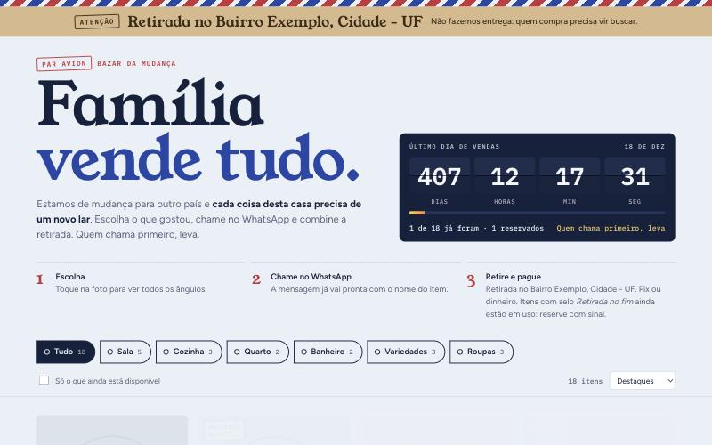
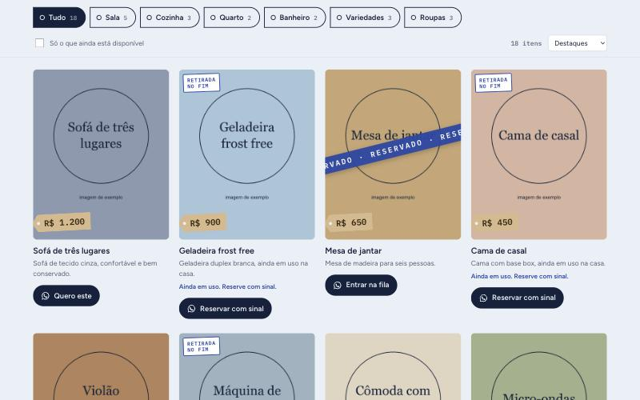
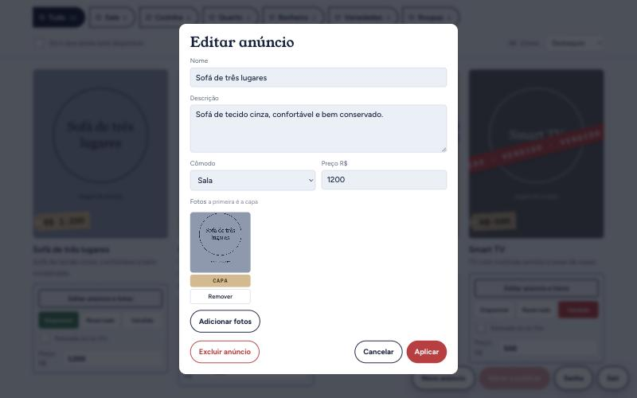
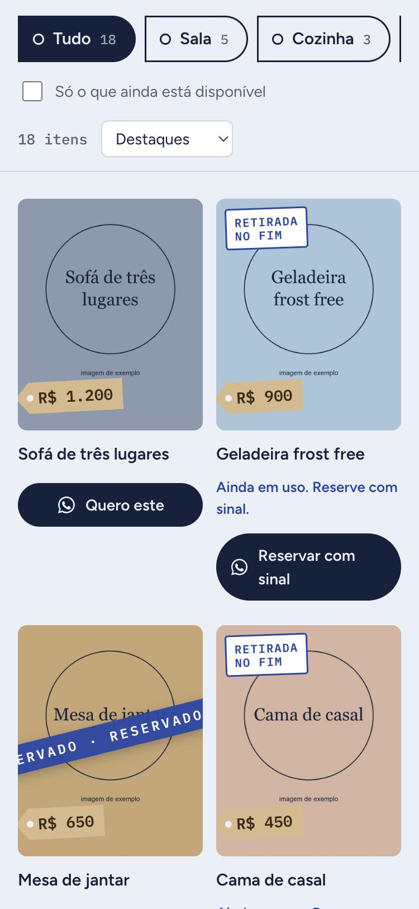

# Bazar da Mudança

Catálogo online para vender tudo de uma casa antes de uma mudança de país, com fotos, preços, contagem regressiva até o último dia de vendas e contato direto pelo WhatsApp. Quem vende administra tudo pelo próprio site, inclusive pelo celular, sem mexer em código.

Foi criado para uma venda real, com mais de 130 anúncios. Este repositório traz o código com um **catálogo de exemplo**: os itens, os preços e as imagens são fictícios.



## O problema

Vender uma casa inteira em poucas semanas por grupos de mensagens é confuso: as fotos se perdem nas conversas, os interessados perguntam várias vezes se um item ainda está disponível e os preços ficam espalhados. O site reúne tudo em um único link, sempre atualizado.

## O que ele faz

**Para quem compra**
- Navega por cômodo, com filtro de itens disponíveis e ordem por preço.
- Vê várias fotos e a descrição de cada anúncio.
- Chama no WhatsApp com a mensagem já pronta, citando o item e o preço.
- Vê na hora o que está disponível, reservado ou vendido, com uma faixa sobre a foto.
- Reserva com sinal os itens que ainda estão em uso na casa.
- Não precisa criar conta nem aceitar cookies.

**Para quem vende (Área da dona)**
- Entra por um endereço próprio, com e-mail e senha. O botão não aparece para visitantes.
- Muda status, preço e descrição, e cria ou exclui anúncios.
- Envia fotos do celular, que são reduzidas e têm os metadados removidos, e escolhe a capa.
- Revisa as alterações antes de publicar todas de uma vez.

| Catálogo | Edição de anúncio | Celular |
|---|---|---|
|  |  |  |

## Como foi construído

- **Interface:** HTML, CSS e JavaScript puros, sem framework nem etapa de build. O visual segue o tema de envelope de carta aérea, com etiquetas de preço e um painel de embarque na contagem regressiva.
- **Servidor:** PHP 8, feito para rodar em hospedagem compartilhada comum.
- **Dados:** um arquivo JSON, sem banco de dados. Para um único administrador e algumas centenas de itens, isso é mais simples de manter e de copiar.

```
public/
  index.php      página pública, já com o catálogo embutido
  api.php        login, salvar, enviar fotos e trocar senha
  app.js         interface e Área da dona
  app.css        estilos, com tema claro e escuro
  data/          catálogo e login (acesso direto bloqueado)
  fotos/         imagens dos anúncios
  dona/          atalho para a tela de login
scripts/         criação do login
tests/           testes da API
```

## Decisões que valem destaque

- **Senha só no servidor:** ela é guardada com `password_hash` e conferida no servidor. Depois de 5 tentativas erradas, o acesso fica bloqueado por 15 minutos.
- **Sessão protegida:** o cookie é `HttpOnly` e `SameSite=Strict`, e as ações exigem um cabeçalho próprio contra envios vindos de outros sites.
- **Visitantes sem cookie:** a sessão só é aberta para quem faz login.
- **Validação no servidor:** todo o catálogo é conferido antes de salvar, inclusive os caminhos das fotos, para impedir acesso a outros arquivos.
- **Envio de imagens:** o tipo real do arquivo é verificado e a imagem é regravada, o que descarta conteúdo escondido.
- **Sem perda de dados:** a gravação é atômica, cada salvamento mantém uma cópia das últimas 30 versões e alterações feitas a partir de uma versão antiga são recusadas.

## Como rodar

Precisa de PHP 8 com a extensão GD.

```sh
cd public
php ../scripts/criar-senha.php data/auth.php voce@exemplo.com uma-senha-longa
php -S 127.0.0.1:8000
```

Abra `http://127.0.0.1:8000` para ver o catálogo e `http://127.0.0.1:8000/#dona` para entrar na Área da dona. O servidor embutido do PHP ignora o `.htaccess`, então o bloqueio da pasta `data` só vale em Apache ou LiteSpeed.

Para publicar em uma hospedagem, envie o conteúdo de `public/` e crie o `data/auth.php` com o script. Os dados da venda ficam em `data/state.json`.

## Testes

```sh
sh tests/rodar_testes.sh
```

São 31 verificações de login, permissões, validação, envio de arquivos, conflito de versões e bloqueio de tentativas, feitas em uma cópia temporária do site.

## Limitações conhecidas

- Foi pensado para uma pessoa administrando. Se dois aparelhos editarem ao mesmo tempo, o segundo é avisado e precisa refazer a alteração.
- Não há recuperação de senha por e-mail.
- Fotos antigas removidas de um anúncio continuam no servidor.
- Os testes cobrem a API; a interface foi verificada manualmente.

## Como foi feito

O código foi escrito com o [Claude Code](https://claude.com/claude-code), da Anthropic. Eu defini o produto e os requisitos, escolhi os caminhos, acompanhei os testes e usei o site em uma venda real, ajustando-o conforme as necessidades que surgiam.
